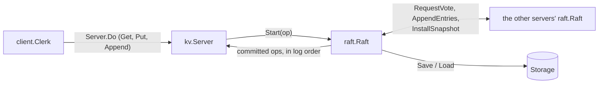

# raft-kv

A replicated key-value store in Go, built on a from-scratch implementation of
the Raft consensus algorithm. A cluster of 3, 5 or 7 servers keeps identical
copies of a map. As long as a majority can reach each other it keeps
answering, and no client sees lost or stale data through crashes, restarts
and network partitions.

- **Correctness:** 300 randomized runs of crashes, restarts, partitions and
  lost or reordered messages, with every operation clients saw checked for
  linearizability by [Porcupine](https://github.com/anishathalye/porcupine):
  **0 violations across 9,042 operations**.
- **Performance:** real server processes over TCP, syncing every write to
  disk. On 5 servers, **12,498 requests/s at a 77 ms median latency** with
  1,024 clients, and writes resume a **median of 387 ms** after the leader is
  killed.

## What it guarantees

- **Linearizable** `Get`, `Put` and `Append`. Reads go through the log too, so
  a leader that has just been replaced can't answer from a stale copy.
- **Exactly-once writes.** A retried `Put` or `Append` whose reply got lost is
  applied once.
- **Durability.** A server syncs its state to disk before it acknowledges
  anything. Any minority can crash, or every server can restart, without
  losing an acknowledged write.
- **Availability with a majority.** Servers on the minority side of a
  partition stop answering instead of answering wrong.

## How it works



Each server is a `kv.Server` on top of a `raft.Raft`. Raft only talks through
two small interfaces, `Transport` and `Storage`, so the same code runs on a
simulated network with in-memory storage in tests and on TCP with real files
in the benchmarks.

**Raft** (`raft/`) follows Figure 2 of the Raft paper, plus snapshots from
Section 7:

- Elections use random 150–300 ms timeouts. A server only votes for a
  candidate whose log is at least as up to date as its own, and saves its
  term and vote before answering.
- Every 30 ms the leader sends each follower the entries it's missing. A
  follower only takes entries that follow one it already has with the same
  term, and only cuts its log at a real conflict.
- A follower that turns entries down says which term conflicts and where that
  term starts, so the leader skips a whole term per round (Section 5.3).
- The leader only counts copies of entries from its own term when deciding
  what's committed (the Figure 8 rule).
- `Start` only appends. Each replication round saves everything new with one
  disk sync before sending it, and the leader counts its own copy only after
  that save.
- The key-value layer snapshots every N entries, and a follower that's too far
  behind gets the snapshot with `InstallSnapshot`.

**Key-value service** (`kv/`, `client/`): every operation is a log entry,
applied in log order. Each client has a random id and numbers its requests;
servers skip a number they've already applied, and that table is part of the
snapshot, so a retry only takes effect once. A server waits up to 300 ms for
a request to commit before answering `ErrTimeout`, or answers
`ErrWrongLeader` with a hint about who leads. Clients wait up to 600 ms,
follow the hint, and retry.

**Network** (`network/`): a simulated network for tests that drops, delays,
reorders and partitions messages, crashes servers, and copies every message
through `encoding/gob`; and a `net/rpc` transport over TCP for the benchmarks,
which drops a connection whenever a call's deadline passes.

**Storage** (`raft/storage.go`): `FileStorage` writes the state and snapshot
to a temporary file, syncs it, renames it over the old one and syncs the
directory, so a crash mid-save leaves the previous save intact.

## Testing

```bash
go test -race ./...
```

The tests cover the simulated network's fault model, elections, replication
with 10% of messages lost, followers catching up, restarts, snapshots,
exactly-once retries while servers crash, and the whole store over TCP and
real files. Randomized tests take a `-seed` flag, which fixes the fault plan
(though not how goroutines get scheduled).

`TestChaos` runs 5 servers and 5 clients on 3 shared keys through five rounds
of random partitions of servers and clients plus a crashed server, each
followed by a heal, with 10% message loss and random delays throughout.
Porcupine then checks that every recorded history is linearizable.

```bash
go test -race -run TestChaos ./kv/ -runs=300
```

Result: 300 of 300 runs linearizable, 9,042 operations checked
(`go test -race -p 1 -cpu 5 -timeout 30m -run TestChaos -v ./kv/ -runs=300`,
151 s).

## Benchmarks

`bench` runs every server as its own process, talking over TCP on loopback
and syncing to real files. Clients are closed-loop: each sends its next
request as soon as the last one returns, half `Put`s and half `Get`s on random
keys.

```bash
go run ./bench throughput -servers 5 -clients 1024 -duration 10s -keys 1000 -value-size 100 -snapshot-every 1000 -server-procs 1
go run ./bench failover   -servers 5 -clients 1024 -trials 40 -keys 1000 -value-size 100 -snapshot-every 1000 -server-procs 1
```

**Setup:** Apple M5 (10 cores), 16 GB, macOS 26.5.2, Go 1.27.2, a laptop with
other apps open. Each server runs with `GOMAXPROCS=1`. 1,000 keys, 100-byte
values, a snapshot every 1,000 entries. Throughput is the median of three
10-second runs, and latency comes from that median run.

### Throughput vs. clients (5 servers)

| Clients | Requests/s | Put median | Put p99 |
|--:|--:|--:|--:|
| 1 | 25 | 40 ms | 49 ms |
| 2 | 49 | 41 ms | 52 ms |
| 4 | 100 | 40 ms | 49 ms |
| 8 | 198 | 40 ms | 50 ms |
| 16 | 390 | 40 ms | 63 ms |
| 32 | 770 | 40 ms | 66 ms |
| 64 | 1,483 | 41 ms | 76 ms |
| 128 | 2,844 | 41 ms | 86 ms |
| 256 | 4,979 | 44 ms | 99 ms |
| 512 | 7,926 | 64 ms | 101 ms |
| 1,024 | 12,498 | 77 ms | 142 ms |
| 2,048 | 14,307 | 138 ms | 206 ms |
| 4,096 | 11,294 | 254 ms | 1,198 ms |


- **The 40 ms floor** is the cost of a commit: waiting for the next
  replication round (every 30 ms), then disk syncs on the leader and the
  followers.
- **Up to 256 clients**, throughput doubles with the clients at flat latency,
  because each round carries every new request in a single sync.
- **Past that, the shared SSD is the limit.** Under load a save takes 20–25 ms
  instead of 9 ms, and most servers spend half to three quarters of every
  second syncing. With the syncs taken out, the same code does 32,156
  requests/s at 1,024 clients (32 ms median) and 55,164 at 4,096. The CPU
  isn't the limit (the busiest server used at most 26% of its core), and
  neither is the network (a loopback echo run alongside had a 99th percentile
  of 364 µs at 1,024 clients).
- **4,096 clients is unstable** on one laptop (the three runs: 15,798, 11,294
  and 3,619 requests/s), and it's as far as this harness goes: more clients
  would need more than the host's 16,384 ephemeral ports.

### Cluster size

Requests/s, with median / p99 Put latency:

| Servers | 256 clients | 1,024 clients | 4,096 clients |
|--:|--:|--:|--:|
| 3 | 6,171 (41 / 80 ms) | 15,006 (72 / 96 ms) | 25,587 (153 / 264 ms) |
| 5 | 4,800 (46 / 97 ms) | 11,679 (82 / 144 ms) | 16,776 (234 / 568 ms) |
| 7 | 3,415 (73 / 140 ms) | 8,612 (115 / 192 ms) | 2,479 (269 / 2,088 ms) |

More servers mean more copies to send and more processes syncing to the same
disk, in exchange for surviving more failures (1 of 3, 2 of 5, 3 of 7).

### Failover

Each trial kills the leader with `SIGKILL` under load and times how long until
a `Put` started right after the kill goes through. 40 kills per cell, as
median / 90th percentile / worst:

| Servers | 256 clients | 1,024 clients | 4,096 clients |
|--:|--:|--:|--:|
| 3 | 292 / 461 / 570 ms | 360 / 672 / 876 ms | 1.1 / 2.4 / 11.1 s |
| 5 | 288 / 399 / 541 ms | 387 / 546 / 1,048 ms | 0.9 / 2.6 / 38.9 s |
| 7 | 297 / 464 / 604 ms | 481 / 641 / 816 ms | 9.5 s / 1 min 51 s / 2 min 18 s |

Up to 1,024 clients, most of the time is the followers waiting out their
election timeouts. At 4,096 clients, each kill sets off a reconnect storm.
With 7 servers, it uses up the host's ports and accept queues, and Raft's own
connections between servers get stuck behind it. All 40 kills recovered, but
some took minutes.

## Bugs the benchmarks found

1. **Throughput collapsed past 16 clients.** Every `Start` synced the whole
   log to disk (about 9 ms) while holding Raft's lock, and the key-value
   handler held its own lock across `Start`, so requests queued until they
   timed out. The fix was one sync per replication round, and no lock held
   across `Start`. 64 clients went from no progress to about 1,480
   requests/s.
2. **Failovers took up to 15 seconds.** A new leader stepped back one entry
   per round to find where a follower's log matched. A follower restarted from
   a snapshot was about 286 entries behind, and commits stalled until it
   caught up. Skipping a whole term at a time (Section 5.3) brought the worst
   case down to 580 ms.
3. **A failover never recovered.** At 4,096 clients, the reconnect storm after
   a kill lost packets, and some connections between servers got stuck in TCP
   retransmission backoff, with 128–300 KB sitting unsent for over 40 seconds.
   The transport kept reusing them, and `net/rpc` writes a request before it
   checks the deadline, so every vote request queued behind the stuck bytes.
   Now a call whose deadline passes closes its connection, and the next call
   dials a fresh one. Before the fix every reproduction stalled for good;
   after it, all 200 kills recovered.

## Known gaps

- **One machine:** every server shares one SSD, kernel and network stack.
  Running across machines was out of scope.
- **Overload isn't graceful:** at 4,096 clients throughput swings and
  failovers can take minutes. A separate port for Raft traffic, as etcd uses,
  would help in part.
- Clients wait 600 ms before giving up on a server, so a client stuck with a
  cut-off server moves on slowly. They also retry without backoff.
- `FileStorage` rewrites the whole log and snapshot on every save, and
  `InstallSnapshot` sends a snapshot in one message.
- There are no read leases, so a `Get` costs a full log round, and no
  membership changes or sharding.

## Layout

```
raft/      Raft: election, replication, commit, snapshots, storage
kv/        the key-value state machine and its request handler
client/    the client library (Clerk)
network/   the simulated network for tests, and the TCP transport
bench/     the benchmark program: throughput and failover
```
