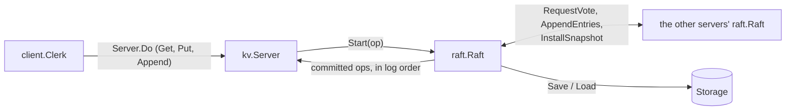
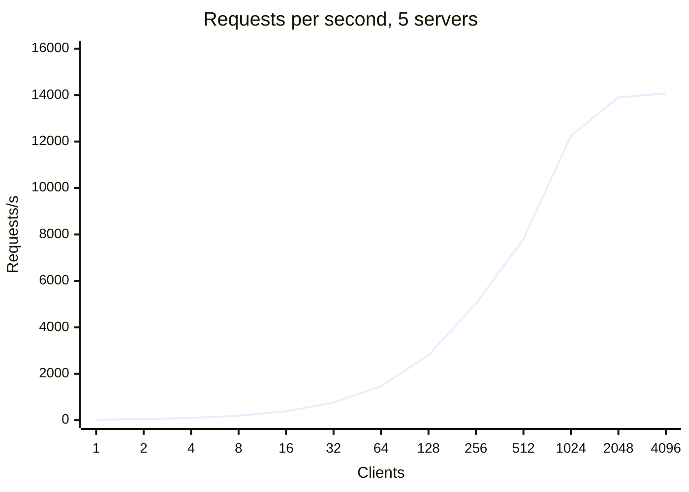
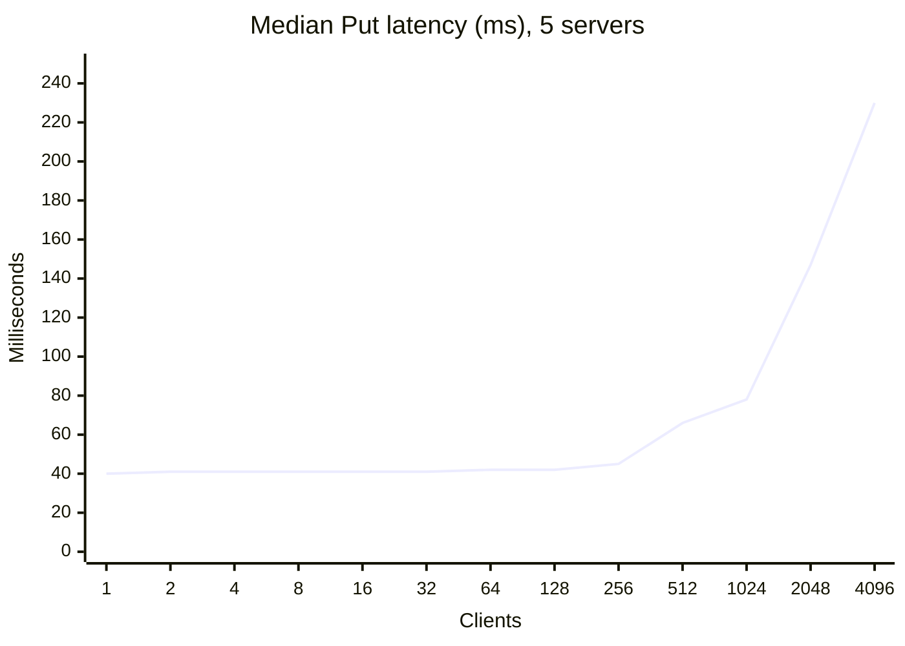

# raft-kv

A replicated key-value store in Go. A cluster of servers (three, five or
seven) keeps identical copies of a map using the Raft consensus algorithm,
built here from the paper without any Raft library. As long as a majority of
the servers are up and can reach each other, the store keeps answering, and
no client ever sees lost or stale data: servers can crash, restart from
disk, and get cut off by network partitions.

Two kinds of evidence back that up:

- **Correctness.** 300 randomized runs of crashes, restarts, partitions, lost
  messages and reordering, with every operation clients saw checked for
  linearizability by [Porcupine](https://github.com/anishathalye/porcupine):
  **0 violations across 12,898 operations**.
- **Performance**, measured with real server processes talking over TCP and
  syncing every write to disk: on a 5-server cluster, **5,026 requests/s at a
  45 ms median latency** with 256 clients, and when the leader is killed,
  writes resume after a **median of 297 ms** (40 kills). The full curve, other
  cluster sizes and the limits of measuring on one laptop are
  [below](#benchmarks).

## What it guarantees

- **Linearizable reads and writes.** `Get`, `Put` and `Append` each appear to
  take effect at a single instant between when the client sent them and when
  the answer came back. That includes `Get`: reads go through the log like
  writes, so a server that has just lost its leadership can't answer from an
  out-of-date copy.
- **Exactly-once writes.** When a reply gets lost and the client retries, the
  retried `Put` or `Append` is applied once, not twice.
- **Durability.** A server writes everything Raft needs to its disk (and waits
  for the disk to confirm) before it tells anyone it has it. Any minority of
  servers can crash at any time, and all of them can crash and restart, without
  losing an acknowledged write.
- **Availability with a majority.** With 5 servers, any 3 that can reach each
  other keep serving. Servers on the minority side of a partition stop
  answering instead of answering wrong.

## How it works



Each server is a `kv.Server` on top of a `raft.Raft`. Clients send every
request to the leader; the leader puts it in the Raft log, and once a
majority of servers have it on disk, every server applies it to its map in
log order. Raft only ever talks through two small interfaces, `Transport`
(send a request, wait for the reply) and `Storage` (save bytes, load bytes),
so the same code runs on a simulated network with in-memory storage in tests
and on TCP with real files in the benchmarks.

### Raft (`raft/`)

The implementation follows Figure 2 of the Raft paper, plus snapshots from
Section 7. The parts worth knowing about:

- **Elections.** A follower that hears nothing from a leader for a random
  150–300 ms becomes a candidate. It wins with votes from a majority, and a
  server only votes for a candidate whose log is at least as up to date as
  its own, which is what guarantees a new leader already has every committed
  entry. Terms and votes are saved before any vote goes out.
- **Replication.** Every 30 ms the leader sends each follower the entries it's
  missing; an empty message is a heartbeat. A follower only takes entries if
  it already has the one they follow, with the same term, so logs stay exact
  copies up to the point where they agree. It only ever cuts its log at a
  real conflict, never because a message is shorter than its log, since a
  short message may be an old one that arrived late.
- **Catching up fast.** When a follower turns entries down, it says which term
  its log disagrees in and where that term starts, so the leader can skip a
  whole term per round instead of stepping back one entry at a time (the
  optimization at the end of Section 5.3). Without it, a follower restarted
  from a snapshot could need hundreds of rounds to catch up; see
  [bug 2](#2-failovers-that-took-up-to-15-seconds).
- **Committing.** The leader commits an entry once a majority have it stored,
  but only counts copies for entries from its own term; older entries commit
  along with them. That's the Figure 8 rule, which stops a leader from
  committing an entry that a later leader could still overwrite.
- **Batching disk writes.** `Start` only appends to the log in memory. Each
  replication round saves everything that arrived since the last one with a
  single disk sync before sending any of it, and the leader's own copy only
  counts toward a majority after that save. One sync per round instead of one
  per request is what lets throughput grow with the number of clients; see
  [bug 1](#1-throughput-that-collapsed-past-16-clients).
- **Snapshots.** The key-value layer snapshots its map every N applied
  entries, and Raft drops the log up to that point. A follower that's behind
  the snapshot gets the whole snapshot with `InstallSnapshot`. A restarted
  server loads its snapshot first, then replays the log entries after it.

### Key-value service (`kv/`, `client/`)

- Every operation, including `Get`, is a log entry, applied to the map by one
  goroutine in log order.
- Each client picks a random 64-bit id and numbers its requests. Retries reuse
  the same number. The map remembers the last number applied for each client
  and skips anything at or below it, and that table is part of the snapshot,
  so a retry is recognized even after a restart.
- A server's request handler registers itself under (client id, request
  number) before handing the op to Raft, and waits up to 300 ms for that exact
  request to be applied. It answers `ErrWrongLeader` with a hint about who the
  leader is, or `ErrTimeout`.
- The client follows the hint if there is one, or tries the next server, and
  keeps retrying until the request goes through.

### Network (`network/`)

- **Simulated network**, used by every test except the TCP ones. Each request
  and each reply is dropped independently with a configurable probability,
  delayed by a random amount (so messages arrive out of order), blocked by
  partitions, and lost if the server crashed since it was sent. Arguments and
  replies are copied through `encoding/gob`, so servers can't share memory by
  accident. A lost call returns when the caller's deadline passes, just like
  on a real network.
- **TCP**, used by the benchmarks: `net/rpc` over one connection per server,
  dialed on first use and redialed after it breaks. A call whose deadline
  passes takes its connection down with it, so the next call starts on a
  fresh one; see [bug 3](#3-a-failover-that-never-recovered).

### Storage (`raft/storage.go`)

`FileStorage` writes the whole state and snapshot to a temporary file, syncs
it to the disk, renames it over the old file and syncs the directory, so a
crash mid-save leaves the previous save intact. On this Mac a save takes
8–9 ms, almost all of it the two syncs (`File.Sync` is a full `F_FULLFSYNC`
on macOS).

## Testing

Everything runs under Go's race detector:

```bash
go test -race ./...
```

What the tests cover, by package:

- `network`: drops, partitions, crashes, delays and reordering behave as
  described; calls copy their arguments; misuse panics. Over TCP: replies come
  back, a restarted server is reached again, connections are reused, and a
  call stuck on a connection that stopped moving returns at its deadline and
  doesn't hold up the next call.
- `raft`: elections at 3 and 5 servers, re-election after the leader is cut
  off, agreement with 10% of messages lost, a follower catching up after
  missing entries, a cut-off leader's entries being replaced, restarts of
  every server and of random servers mid-run, the log staying short with
  snapshots, a follower catching up from a snapshot, and file storage
  surviving an interrupted save.
- `kv`: the basic operations, leader changes, retried appends applied exactly
  once while servers crash, state surviving a full restart, the whole store
  over real TCP and files, and the chaos test below.

Randomized tests take a `-seed` flag and print their seed when they fail. The
seed fixes the fault plan (which messages drop, which servers crash, which
partitions form) but not how goroutines get scheduled, so a failing seed may
need a few reruns to fail again.

### The chaos test

`TestChaos` (in `kv/chaos_test.go`) runs 5 servers and 5 clients reading and
writing 3 shared keys for five rounds. Each round splits the servers and
clients into random groups and crashes a server, then heals everything and
restarts it, with 10% of messages dropped and random delays the whole time.
Every operation is recorded with when it started and finished, and
[Porcupine](https://github.com/anishathalye/porcupine) checks that the whole
history could have come from a single copy of the map that each operation hit
at one instant. The normal suite runs it 3 times; to run more:

```bash
go test -race -run TestChaos ./kv/ -runs=300
```

**Result: 300 of 300 runs linearizable, 12,898 operations checked** (14 to
90 per run; most of each run is spent with the cluster split or recovering,
which is the point). Produced by
`go test -race -p 1 -cpu 5 -timeout 30m -run TestChaos -v ./kv/ -runs=300`
on the machine described under [Benchmarks](#benchmarks), limited to 5 cores,
in 145 s.

### Mutation testing

To check that the tests would catch real mistakes, the code was broken on
purpose, one change at a time, and the suite run against each broken copy, as
each piece was written. It catches, among others: skipping the log-matching
check, voting without the up-to-date check, never committing, setting
`matchIndex` from the leader's log instead of from what was sent, not saving
before voting, before starting an election, before stepping down to a newer
term or before acknowledging entries, not handing a snapshot to the
application, never trimming the log, not deduplicating retries, retrying with
a new request number, leaving the dedup table out of the snapshot, and
answering `Get` without going through the log.

It does **not** catch these five, rechecked against the final code. Each
would break safety, but only in a specific interleaving that random faults
rarely line up:

- dropping the Figure 8 rule, so a leader commits an older term's entry just
  because a majority has it;
- the leader counting its own copy toward a majority before saving it;
- a follower cutting its log at every message instead of only at a real
  conflict;
- a follower throwing away its whole log on `InstallSnapshot`, even when the
  entries after the snapshot match;
- dropping the check that ignores a snapshot older than the one a server
  already has.

Each would need a scripted test that sets up its interleaving directly. (Each
mutant was run against `go test -race -p 1 -cpu 5 -count=3 ./raft/ ./kv/`,
which includes 9 chaos runs.)

## Benchmarks

`bench` runs each server as its own process on this machine, talking over TCP
on the loopback interface and saving to real files with full disk syncs.
Clients are closed-loop: each sends its next request as soon as the last one
returns. Half the requests are `Put`s and half `Get`s, on keys picked at random.

```bash
go run ./bench throughput -servers 5 -clients 256 -duration 10s -keys 1000 -value-size 100 -snapshot-every 1000 -server-procs 1
go run ./bench failover   -servers 5 -clients 256 -trials 40 -keys 1000 -value-size 100 -snapshot-every 1000 -server-procs 1
```

**Setup for every number below:** Apple M5 (10 cores), 16 GB, macOS 26.5.2,
Go 1.27.2. Each server process runs with `GOMAXPROCS=1`, so its Go code uses
one core; the client driver uses the rest. 1,000 keys, 100-byte values, a
snapshot every 1,000 entries. Throughput is the median of three 10-second
runs; latency comes from the run with the median throughput. This is a laptop
with other apps open (41% of memory free at the start), not a quiet benchmark
machine.

### Throughput and latency vs. number of clients (5 servers)

| Clients | Requests/s | Put median | Put p99 |
|--:|--:|--:|--:|
| 1 | 25 | 40 ms | 51 ms |
| 2 | 49 | 41 ms | 51 ms |
| 4 | 98 | 41 ms | 50 ms |
| 8 | 195 | 41 ms | 51 ms |
| 16 | 384 | 41 ms | 63 ms |
| 32 | 757 | 41 ms | 70 ms |
| 64 | 1,464 | 42 ms | 78 ms |
| 128 | 2,803 | 42 ms | 84 ms |
| 256 | 5,026 | 45 ms | 92 ms |
| 512 | 7,800 | 66 ms | 100 ms |
| 1,024 | 12,251 | 78 ms | 135 ms |
| 2,048 | 13,900 | 147 ms | 212 ms |
| 4,096 | 14,071 | 230 ms | 1,557 ms |





Reading the curve:

- **The 40 ms floor** at one client is the cost of a commit: waiting for the
  next replication round (up to 30 ms), the leader's disk sync, then a
  follower's disk sync before a majority has the entry (about 9 ms each).
  `Get`s cost the same as `Put`s because they go through the log too.
- **Up to 256 clients, throughput doubles with the clients and latency barely
  moves**, because a replication round carries everything that arrived since
  the last one with one disk sync, however many requests that is.
- **Past 256 clients, latency starts to climb** and throughput grows more
  slowly, leveling off around 14,000 requests/s. The servers aren't short
  of CPU: sampled with `top` in the middle of a run, the busiest server
  process, which is the leader since it does the most work, used about 11% of
  its one core at 256 clients and 26% at 4,096, and the others less. What
  all five servers do share on one laptop is a single SSD, which takes every
  one of their disk syncs, and the kernel's loopback networking. These
  measurements don't separate which of the two sets the ceiling.
- **The top of the curve measures this machine as much as the store.** With
  4,096 clients on one host, the kernel's loopback networking becomes a
  bottleneck in its own right: an unrelated 1-byte TCP echo running alongside
  went from about 62 µs to a 2 ms median, with spikes to 190 ms, during
  healthy runs at that load. 4,096 is also as far as this harness can go: 4,096
  clients each connecting to 5 servers would need more than the 16,384
  ephemeral ports one host has.

### Cluster size

| Servers | 256 clients | Put median / p99 | 4,096 clients | Put median / p99 |
|--:|--:|--:|--:|--:|
| 3 | 5,721 req/s | 42 / 74 ms | 26,007 req/s | 152 / 238 ms |
| 5 | 4,947 req/s | 45 / 93 ms | 14,089 req/s | 239 / 1,364 ms |
| 7 | 3,361 req/s | 73 / 138 ms | 649 req/s (runs: 6,638, 649, 383) | 234 / 671 ms |

These are separate runs from the sweep above, so the 5-server rows differ
from it by up to 2%.

More servers mean more copies to send and more followers to hear back from,
so throughput drops as the cluster grows, in exchange for surviving more
failures (1 of 3, 2 of 5, 3 of 7).

### Failover

Each trial kills the leader with `SIGKILL` while the clients keep the cluster
busy, then times how long until a `Put` that started right after the kill goes
through. That includes the client giving up on the dead server, not just the
election.

Time until writes go through again after the leader is killed, 40 kills per
row:

| Servers | 256 clients: median | 90th pct | worst | 4,096 clients: median | 90th pct | worst |
|--:|--:|--:|--:|--:|--:|--:|
| 3 | 311 ms | 565 ms | 810 ms | 1.0 s | 3.2 s | 9.2 s |
| 5 | 297 ms | 478 ms | 540 ms | 1.0 s | 3.5 s | 21.0 s |
| 7 | 308 ms | 410 ms | 681 ms | 8.0 s | 36.8 s | 1 min 23 s |

At 256 clients, writes resume about 300 ms after the kill, most of which is
the followers waiting out their 150–300 ms election timeouts before they
notice the leader is gone. At 4,096 clients, every kill sets off the
reconnect storm from [bug 3](#3-a-failover-that-never-recovered). The cluster
always recovers now (two more runs of 40 kills at 5 servers gave medians of
1.4 s and 1.0 s, worsts of 22.9 s and 17.8 s), but how long it takes depends
on how hard the storm hits this one machine. Seven servers with 4,096 clients
is more than this laptop can run at all, as the throughput table shows.

## Bugs the benchmarks found

The test suite runs everything on a simulated network in one process.
Measuring real processes on real disks turned up three problems it couldn't
see.

### 1. Throughput that collapsed past 16 clients

The first benchmark peaked around 63 requests/s and fell to nearly zero at 32
clients. Two things compounded. Every `Start` synced the whole log to disk
(about 9 ms) while holding Raft's lock, so the leader could take at most about
110 commands a second, and with 32 clients each request queued behind roughly
288 ms of other requests' syncs, close to the 300 ms the client and server
wait before giving up. On top of that, the key-value handler held its own lock
across `Start`, so the loop applying committed entries queued behind all of
that too. Requests timed out, clients retried, and the retries made the queue
longer.

The fix: handlers stop holding their lock across `Start` (they register as
waiting for their own request first), and Raft syncs once per replication
round instead of once per command. With 64 clients that went from no progress
to about 1,480 requests/s at a 41 ms median. Sending each command out the
moment `Start` got it was also tried, and measured to cut throughput about
three times under load, because followers then received a stream of
overlapping messages that each cost them a disk sync; it was taken back out.

### 2. Failovers that took up to 15 seconds

Most failovers at 256 clients took under 300 ms, but 9 of 40 took over a
second, and the worst took 14.9 s. Logging the new leader showed why. It
started out assuming each follower's log matched its own and, on every
rejection, stepped back one entry per 30 ms round. A follower that had just
restarted from a snapshot was about 286 entries behind, which took 286
rounds, and commits stopped meanwhile because there weren't enough
up-to-date followers to form a majority. Adding the conflict-term
optimization from Section 5.3 brought the worst case to 580 ms over 40 kills.

### 3. A failover that never recovered

At 4,096 clients, a leader kill sometimes left the cluster with no leader for
good: 19 minutes, with every surviving server nearly idle. It took several
experiments to find, because two separate problems were stacked.

First, the machine. When the leader dies, 4,096 clients reconnect at once.
Every server's queue of connections waiting to be accepted filled up (macOS
allows 128), hundreds of connection attempts to the dead server's port hung
instead of being refused, and the client driver ran out of ephemeral ports.
An unrelated loopback echo running alongside slowed from 62 µs to 0.2–2.4 s,
with the kernel using a full core. That storm is the machine's problem, not
Raft's, and it passes. Raft's own timings stayed normal throughout (vote
handlers under 30 ms, disk syncs 8–20 ms, lock waits around 100 ns).

Second, the bug. Even after the echo was back to 10 µs, the servers still
couldn't elect anyone: candidates kept sending vote requests over open
connections, and no server's vote handler ever ran. `netstat` showed why. On
those connections, 128–300 KB sat in the sender's kernel buffer and didn't
move for over 40 seconds, while the receiver had read everything that reached
it: what TCP does while it waits out a long retransmission backoff after
losing packets, as it had during the storm. The transport kept using those
connections, and `net/rpc` writes a request before the caller's deadline is
even looked at, so every later call to that peer queued behind the stuck
bytes, however short its deadline. A fresh connection would have worked
immediately.

The fix: when a call's deadline passes, the transport closes that connection,
which also unblocks a send stuck on it, and the next call dials a new one.
Before the fix, every run of the reproduction (five of them) stalled for
good, each within its first 16 kills. After it, all 200 kills at 4,096
clients recovered, across 3, 5 and 7 servers. (Giving the Raft traffic its
own port, and making clients pause after a sweep of failures, were each tried
first; neither stopped the stall.)

## Known gaps and limits

- **One machine.** Every server shares one SSD, one kernel and one network
  stack, which a real deployment wouldn't, and the numbers at the top of the
  curve reflect that (see [Benchmarks](#benchmarks)). Deploying across
  machines was out of scope.
- **Under overload, clients give up as soon as the server does.** The server
  waits 300 ms for a request to commit before answering `ErrTimeout`, and the
  client also waits 300 ms, so once requests take that long the client gives
  up first. Since the fix for bug 3, that also closes its connection, so
  overload turns into reconnect churn: 7 servers at 4,096 clients fell to 649
  requests/s. A client that waits twice as long (600 ms) was also measured:
  5 servers at 4,096 clients went from 14,071 to 16,110 requests/s (p99 from
  1.6 s to 0.75 s), 7 servers from 649 to 3,920, and failover at 256 clients
  didn't change (median 293 ms, worst 576 ms).
- **No retry backoff.** A client that can't find a leader goes straight on to
  the next server. That keeps failover short at normal load, but it's what
  turns a leader kill into a reconnect storm at 4,096 clients.
- **Every save rewrites everything.** `FileStorage` rewrites the whole log and
  snapshot on every save, so a save costs more the longer the log gets.
  Snapshots every 1,000 entries keep that bounded while commits flow; when
  commits stop, as they did in bug 3, the log and each save keep growing.
- **Snapshots go in one message.** `InstallSnapshot` sends the whole
  snapshot at once, with no chunking. Fine for 1,000 keys of 100 bytes; not
  for a large store.
- **Every read costs a log round.** There are no read leases or ReadIndex, so
  a `Get` is as expensive as a `Put`.
- **No membership changes or sharding.** The set of servers is fixed when
  the cluster starts, and every server holds every key.
- **The five mutants above** that no test catches.

## Layout

```
raft/      Raft: election, replication, commit, snapshots, storage
kv/        the key-value state machine and its request handler
client/    the client library (Clerk)
network/   the simulated network for tests, and the TCP transport
bench/     the benchmark program: throughput and failover
```
